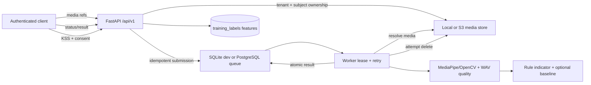

# Wellar V2 Release Readiness Audit

Audit date: 2026-10-16. Scope: backend source, checked-in docs/deployment, and the safe existing test suite. No production service was contacted; no private-pilot media, secrets, dataset searches, or training were used. No `LEGACY_AI_INTEGRATION_MAP.md` was found in the repository file listing. Repository status could not be inspected because this workspace has no `.git` metadata (`git status --short`: “fatal: not a git repository”).

## A) Executive summary

1. **Decision: DO NOT SHIP** to the stated 2,000-user burst requirement.
2. The API → queue → worker → result path is implemented with tenant/subject ownership checks and idempotency.
3. The output is explicitly labeled indicative/non-diagnostic, and the four eye/face states are rule based.
4. Media deletion is attempted after ordinary per-modality processing, but resolve failures, poison jobs, process crashes, and queued items can retain media.
5. No user-label withdrawal or training-label expiry path exists; consent is not yet a complete lifecycle.
6. Runtime OpenAPI is generated by FastAPI, but a versioned checked-in integration contract and legacy compatibility evidence are absent.
7. PostgreSQL/S3 deployment is documented as a template and explicitly not verified for staging; SQLite is single-host development only.
8. The safe suite passed 169 tests; four live PostgreSQL/MinIO tests skipped because integration services were not configured.
9. No end-to-end scan latency or 2,000-submit burst benchmark was run for this audit; capacity remains unverified.
10. Ship only after deletion/consent lifecycle, burst capacity, live distributed integration, and owner acceptance are verified.

## B) Readiness by area

| # | Area | Readiness | One-line basis |
|---|---|---:|---|
| 1 | Architecture and dataflow | 70% | Complete local and distributed adapter paths exist; media cleanup has uncovered failure paths. |
| 2 | API contract | 55% | FastAPI schemas/routes and runtime OpenAPI exist; static contract and legacy-response verification are absent. |
| 3 | Inference pipeline | 55% | MediaPipe eye features are extracted, but the short-clip fraction is still exposed under a PERCLOS name. |
| 4 | Indicator rules + config | 55% | Four states and thresholds exist; threshold validation/version enforcement and pose gates are absent. |
| 5 | Quality gates and abstention | 60% | Several quality failures abstain; coverage and failure paths are not consistently fail-closed. |
| 6 | Personal baseline | 65% | Tenant/subject-scoped capped history and robust median/MAD z-score exist; drift/freshness are unhandled. |
| 7 | Labels and consent | 35% | KSS consent-gated feature capture exists; withdrawal/expiry and DB parity are missing. |
| 8 | Media lifecycle and deletion | 25% | Normal processing deletes media; queue, resolve, crash, and poison paths are not proven to delete. |
| 9 | Privacy and security | 50% | Auth, owner checks, upload caps and media validation exist; rate controls and adversarial decode testing are incomplete. |
| 10 | Performance and capacity | 15% | No full-scan CPU-seconds or burst measurement; scalable deployment is only a template. |
| 11 | Reliability | 55% | Leases, retries, fencing and idempotency exist; processor timeouts and poison-media cleanup are missing. |
| 12 | Observability | 45% | JSON logs, health/readiness and local counters exist; exporter, alerting and scan-level SLO evidence are absent. |
| 13 | Deployment | 35% | Docker/EasyPanel instructions exist; docs disclaim verified staging, HA, backup, resources and rollback. |
| 14 | Tests | 70% | Safe suite passes; real Postgres/MinIO and full privacy/deletion failure tests skipped or absent. |
| 15 | Code health | 45% | Production path coexists with research modules and dense one-line implementation; Git diff provenance unavailable. |
| 16 | Docs | 45% | Useful developer/deployment docs exist; no complete versioned API, calibration/threshold, or production runbook. |
| 17 | Integration readiness | 40% | API routes/auth and EasyPanel guidance exist; Flutter/Directus contract acceptance and legacy mapping are unverified. |

**Overall readiness: 47%** (unweighted mean of the 17 area scores above; judgment score, not a measured system metric).

## C) Findings

Effort estimates are engineering estimates, not commitments. Severity reflects the stated product and release requirements.

| ID | Area | Severity | Evidence | Fix | Effort (h) |
|---|---|---|---|---|---:|
| F-01 | Media lifecycle | BLOCKER | `app/media/analysis.py:92` resolves media before the per-asset `try/finally` at `:140`; a missing asset continues without delete. `README.md:44` says retention does not remove media referenced by queued/processing scans. `app/workers/worker.py:38-48` handles malformed jobs before invoking the processor. | Add owner-safe cleanup for unresolved refs, terminal/poison jobs, and startup orphan/scratch reconciliation; prove deletion with injected resolve, decode, worker crash, and object-store failures. | 12–24 |
| F-02 | Labels and consent | BLOCKER | Only `POST /api/v1/scans/{scan_id}/labels/kss` is present (`app/api/v1.py:100-121`). `app/media/retention.py:11-20` purges media only; no label-withdrawal or label-retention purge route/job found. | Implement authenticated withdrawal and expiry for retained feature labels, record consent changes, and test deletion across every configured store. | 12–20 |
| F-03 | Performance and capacity | BLOCKER | `README.md:70` explicitly scopes existing benchmark numbers to synthetic queue/storage/extraction, not full scan/network. No 2,000-submit/full-scan measurement was run for this audit. | Run representative non-pilot synthetic load against a disposable deployment; profile decode/MediaPipe/DB/object transfer; size replicas with measured CPU-seconds and p95. | 16–32 |
| F-04 | Deployment and distributed stores | BLOCKER | `README.md:26` labels distributed adapter config “not yet verified for staging”; `:48` says template only and no evidence HA/network/IAM/backup/scaling/resources exist. Four Postgres/MinIO integration tests skipped. | Stand up isolated staging dependencies, run migrations and API/worker acceptance, and validate backup/restore, limits, monitoring and rollback. | 16–32 |
| F-05 | Inference semantics | HIGH | `app/media/extractors.py:134` copies `observed_eye_closure_fraction` to `perclos_estimate`; preceding feature semantics at `:100` explicitly describe a short-clip observed fraction, not PERCLOS. `app/media/analysis.py:204` maps it under `perclos`. | Rename to `short_clip_eye_closure_fraction` through API/schema/storage; preserve legacy field only as deprecated nullable compatibility alias if owner requires it. | 4–8 |
| F-06 | API contract / compatibility | HIGH | `app/main.py:54` reports API version `0.1.0`; FastAPI generates OpenAPI at runtime. No checked-in OpenAPI contract or legacy integration map was found. `ScanResult` in `app/scans/schemas.py:80-110` includes newer fields. | Publish versioned OpenAPI, capture legacy response fixture from owner-approved source, and test response compatibility and deprecation behavior. | 6–12 |
| F-07 | Quality gates / pose | HIGH | `app/drowsiness_indicator.py:35-47` gates face ratio, luminance, blur and optional audio status, but no head-pose/off-camera criterion is represented. Video extractor accepts low temporal coverage at configured thresholds (`app/media/extractors.py:23-25, 100`). | Add pose/off-camera quality evidence or explicitly document it unsupported; strengthen minimum temporal coverage and test partial face, occlusion and low-light cases. | 8–16 |
| F-08 | Threshold config | HIGH | `app/drowsiness_indicator.py:12-17` checks label and that `states` is a dict only. No supported config version, numeric range, state-key, or monotonicity validation is enforced. | Validate schema/version, finite bounded values and ordered severity thresholds at load; fail startup on invalid config; add boundary/property tests. | 4–8 |
| F-09 | Label persistence parity | HIGH | SQLite table at `app/queue/sqlite_store.py:125` lacks the Postgres migration’s scan foreign key (`deployment/migrations/003_training_labels.up.sql:1-12`). Postgres and SQLite label store methods differ in ownership/completion checks (`app/queue/postgres_store.py:226`, `app/queue/sqlite_store.py:439`). | Align constraints and validation in both backends; write parity tests for repeated labels, missing scan, ownership, cascade and expiry. | 6–12 |
| F-10 | Worker reliability | HIGH | `app/workers/worker.py:67-83` maintains a lease heartbeat but runs processor synchronously without a processing deadline; `app/workers/entrypoint.py:35-37` stops via signal without documented bounded shutdown. | Add bounded per-stage timeouts and shutdown drain policy; ensure cancellation still releases/deletes assets; test slow/hung extractor and lease expiry. | 8–16 |
| F-11 | Capacity/backpressure | HIGH | `app/core/config.py:30-38,100-103` defines large byte caps (up to 1 GiB global media), and upload concurrency is bounded; queue-full handling is 503 (not 429). No per-principal request rate limiter was found; `app/main.py:66` installs only request context middleware. | Add per-tenant/user throttles and documented retry hints; tune queue/media quotas from burst tests; define overload behavior for synchronous scan submission. | 8–16 |
| F-12 | Container runtime | HIGH | Root `Dockerfile:1-11` defaults `WELLAR_ENV=development` and starts only Uvicorn; it has no healthcheck. `Dockerfile.easypanel:22-24` has API readiness healthcheck. | Make the production image fail closed by default; publish immutable API/worker deployment profiles and resource limits; ensure healthcheck semantics distinguish liveness/readiness. | 4–8 |
| F-13 | OpenAPI and errors | MED | Routes include upload/delete/submit/result/KSS (`app/api/v1.py:33-121`), but explicit stable error response schemas and OpenAPI artifact are not present in repo. | Freeze request/response/error schemas and generate checked-in OpenAPI as CI drift check. | 4–8 |
| F-14 | Logging privacy | MED | `app/core/logging.py:19-21` redacts common secrets/emails; request middleware accepts caller-provided IDs (`app/api/middleware.py:22-24`), and worker logs scan/job IDs (`app/workers/worker.py:65-97`). No raw media is logged by inspected code, but exhaustive sink verification was not performed. | Treat identifiers as pseudonymous personal data; minimize/rotate retention and verify all exception/exporter sinks with synthetic canary values. | 4–8 |
| F-15 | Security abuse controls | MED | Per-modality byte caps and decode limits exist (`app/core/config.py:30-38,92-103`); no API rate-limit middleware found. Video decoding uses OpenCV and is in-process (`app/media/extractors.py`); adversarial codec/decompression stress was not run. | Add decoder resource isolation/timeouts and request throttles; test malformed, oversized, high-complexity media without pilot data. | 8–16 |
| F-16 | Observability | MED | `/health` and `/ready` at `app/main.py:99-131`; bounded counters are in-process per `README.md:48`, exporter/alerts are an operator setup. | Export queue age, lease expiry, scan latency, deletion failures and worker heartbeat; define alert thresholds and owner. | 8–16 |
| F-17 | Legacy integration | MED | Legacy integration map absent; README routes API under `/api/v1` and `ScanResult` schema differs from older generic targets (`app/scans/schemas.py:80-110`). No Flutter/Directus consumer contract verification was performed. | Obtain owner-approved legacy response and consumer expectations; build contract tests without changing Flutter/Directus. | 4–12 |
| F-18 | Scientific/user wording | MED | Indicator label is `indicative, non-diagnostic, not a validated classifier` (`app/drowsiness_indicator.py:8-9`); analysis response message repeats indicative/non-diagnostic (`app/media/analysis.py:231`). However a short-clip fraction is named PERCLOS and indicator state thresholds have no calibration evidence. | Keep the caution in API/UI copy and publish a threshold rationale/limitations note; avoid PERCLOS term until validated protocol supports it. | 3–6 |
| F-19 | Baseline | LOW | `app/drowsiness_indicator.py:24-33` uses median/MAD and returns no z when MAD is zero; `app/queue/sqlite_store.py:450` retrieves baseline history. History is tenant/subject scoped and capped at 100 in query; drift/freshness handling was not found. | Define reference window, stale-data/drift behavior and baseline version; test tenant changes and repeated/constant values. | 4–8 |
| F-20 | Dependency audit | MED | Safe tests ran with local locked environment; `pip-audit` availability/offline CVE check was not established. No network CVE scan was run. | Run approved offline vulnerability inventory or controlled dependency scanner; track remediation by locked version. | 2–6 |

## Architecture/dataflow

Verified code path: authenticated client uploads each modality to `POST /api/v1/media/{modality}`; media references are owner-scoped and stored by local or S3 adapter. `POST /api/v1/scans` resolves/validates references, requires `Idempotency-Key`, and submits a job to SQLite or PostgreSQL. Worker claims a lease, invokes `MultimodalFeatureProcessor`, extracts image/video/audio features, computes the rule indicator, attempts per-reference deletion, and commits the result. Client reads status/result through owner-scoped GET routes. See `app/api/v1.py:33-97`, `app/scans/service.py:21-...`, `app/workers/worker.py:34-98`, `app/media/analysis.py:82-231`, and `app/core/adapters.py:1-14`.

The diagram’s “attempt delete” is deliberately not a guarantee: F-01 identifies paths that bypass it.

## D) Works and verified

- Safe existing suite: **169 passed, 4 skipped, 0 failed**, one Starlette deprecation warning, 13.91 s. Skips: two MinIO and two PostgreSQL live integration cases because service variables were not configured.
- Authentication is mandatory at the API principal dependency (`app/api/v1.py:21-29`); scan/media access checks tenant and subject ownership (`app/api/v1.py:42-97`). OIDC verifies issuer/audience/expiry/signature; Directus mode validates `/users/me` and active membership (`app/security/auth.py`, `README.md:46`).
- Scan submission requires `Idempotency-Key`, with validation in `app/api/v1.py:51-57` and service (`app/scans/service.py:21`).
- Rule output contains exactly the configured four states and caution label (`app/drowsiness_indicator.py:8-9`); rules use measured eye/face variables. Audio may fail the quality gate, but is not fed into severity rules (`app/media/analysis.py:204-222`).
- Basic media size/type/decoder limits and owner-scoped storage are implemented (`app/core/config.py:30-38,92-103`, `app/media/storage.py`, `app/media/extractors.py`).
- KSS is constrained 1..9 and consent is explicit (`app/scans/labels.py`); false consent returns without retention (`app/api/v1.py:100-108`); feature retention uses a fixed allowlist (`:110-121`).
- Baseline is descriptive median/MAD and is omitted when not ready or dispersion is zero (`app/drowsiness_indicator.py:24-33`); history is tenant/subject scoped and capped (`app/queue/sqlite_store.py:445-455`, Postgres equivalent `app/queue/postgres_store.py:232-244`).
- Local test edits were checked against `backups/tonight-pre-edit-20261016/`: two expectation changes are present in `tests/test_media.py` (ordinary scan media is now deleted) and `tests/test_self_test_runner_e2e.py` (post-processing DELETE returns 404). The backups do not establish the full owner-change history because Git metadata is absent.
- Runtime API includes health/readiness checks (`app/main.py:99-131`) and docs provide staged EasyPanel service roles (`deployment/easypanel/README.md:7-14`).

## UNVERIFIED

- Real production/staging scan timings, CPU-seconds, cold model load, 2,000 concurrent submissions, queue saturation and number of replicas required.
- Media deletion on process crash, poison job, failure to resolve S3 object, failed object deletion, container restart, and every scratch/storage layer.
- Actual Postgres/S3 behavior: live integration tests skipped; docs say staging is unverified (`README.md:26,48`).
- Consumer compatibility with Flutter, Directus, or legacy response shape; no map found and no consumer test evidence available.
- Actual secret values were not read; environment variable names were not exhaustively audited. No dependency CVE scan was completed.
- Demographic/performance robustness for glasses, darker skin, head coverings, off-camera behavior, partial face, device-specific fps, codec edge cases, or low-light conditions.
- Egyptian PDPL operational implementation, retention periods, cross-border transfers, processor agreements, and DPO/owner approvals. Technical items below are not legal advice.
- OpenAPI runtime output was not exported and diff-checked against a stable published contract.

## Security/privacy and Egyptian PDPL technical implications

Backend protections verified: bearer authentication, ownership checks, modality byte caps, image/video decode bounds, no public S3 URLs, and common secret/email redaction. Gaps include no observed per-user API rate limiter, unisolated native media decoding, unproven complete deletion, and pseudonymous scan/job IDs in logs. For Law 151/2020 implementation planning (not legal advice), obtain owner/counsel decisions for: clear notice and purpose/legal basis; minimize collection; consent capture/withdrawal and proof; access/correction/erasure/restriction requests; retention and deletion propagation to backups/processors; access control and incident/breach response; processor/vendor and cross-border transfer approvals; and Arabic/accessible user-facing notices. The Egyptian PDPC portal publishes rights/guidance and consent/privacy notice materials: [PDPC portal](https://pdpc.gov.eg/), [consent guidelines](https://pdpc.gov.eg/assets/pdf-data/Guidelines/DSConsent.pdf), [privacy notice guidelines](https://pdpc.gov.eg/assets/pdf-data/Guidelines/Privacy%20Notice.pdf).

## Deployment/config matrix

The repository documents secret names without exposing values. Main configuration families include `WELLAR_ENV`, `WELLAR_QUEUE_BACKEND`, `WELLAR_POSTGRES_DSN`, `WELLAR_POSTGRES_AUTO_MIGRATE`, `WELLAR_MEDIA_BACKEND`, `WELLAR_S3_BUCKET`, `WELLAR_S3_REGION`, `WELLAR_AUTH_MODE`, `WELLAR_OIDC_ISSUER`, `WELLAR_OIDC_AUDIENCE`, `WELLAR_OIDC_JWKS_URI`, `WELLAR_DIRECTUS_BASE_URL`, `WELLAR_MEDIA_RETENTION_DAYS`, worker/lease/retry settings, size caps, concurrency caps and model-inference toggles. Names are documented in `app/core/config.py` and `deployment/easypanel/README.md:20-40`; no values are reproduced. Docker image installs locked requirements and runs non-root (`Dockerfile.easypanel:15-24`); staging migrations are a separate controlled step (`deployment/easypanel/README.md:46`). EasyPanel deployment, backups/restores, alerts and rollback are expressly not run/accepted (`:51,57`).

## E) Ordered fix plan

### Tonight

1. Block release on F-01: define deletion ownership for resolve failure, queue poison, and crash recovery; add failure-injection tests.
2. Block label collection until withdrawal and expiry exist; implement per-user/tenant deletion and verify both SQLite and Postgres.
3. Rename short-clip eye closure fraction so output does not imply clinically validated PERCLOS.
4. Validate config schema/version/ranges and add pose/off-camera abstention or explicitly remove unsupported claims.
5. Publish a versioned OpenAPI contract and obtain owner-approved Flutter/Directus/legacy compatibility fixtures.

### This week

1. Run isolated PostgreSQL + S3/MinIO live integration, migration up/down, deletion and recovery exercises.
2. Measure complete scan latency and CPU-seconds across concurrency 1/10/50/2000 with only synthetic fixtures; profile model cold/warm startup and decoder bottlenecks.
3. Add request throttles, explicit upload timeout/decoder isolation and bounded graceful shutdown.
4. Add metrics export/alerts for queue age, p95 latency, failed cleanup, worker heartbeat and terminal jobs.
5. Run approved offline dependency CVE inventory and verify log sinks with synthetic canary PII.

### After launch

1. Tune rule thresholds only with owner-approved prospective validation; preserve non-diagnostic wording until validated.
2. Add baseline freshness/drift controls and demographic/device-specific usability evaluation.
3. Reassess consent/retention policy, PDPL controls, backup deletion semantics and incident procedures with owner and counsel.

## F) Open questions only the owner can answer

- What are the approved production hosting region, data residency and cross-border transfer constraints?
- What retention duration applies to media, features, logs, and backups, and who approves exceptions?
- Who is controller/DPO and who owns consent withdrawal, deletion verification, breach response and user requests?
- What is the authoritative Flutter/Directus/legacy API response contract and migration window?
- What hardware/service quota and cost ceiling are available for the 2,000–5,000 user burst target?
- Are four rule-based states approved for user display, and what safety language/escalation path should accompany “High Risk”?
- Which staging credentials/services may be provisioned for live PostgreSQL/S3 verification, and who accepts the release gate?

## Test record

Command: `python -m pytest -q tests` with nine explicit excludes for training, dataset qualification, research evaluation/classifiers, real-media/pilot workflows, short-mobile KSS research, and repository hygiene. Result: **169 passed / 0 failed / 4 skipped**. This was not a full test-suite run; excluded tests were intentionally not run under audit constraints. No coverage report was produced. The four skipped live integration tests are detailed above.
